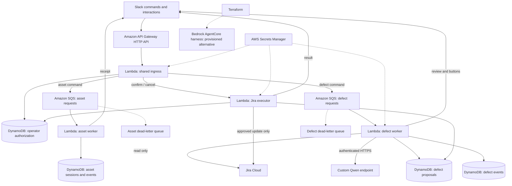
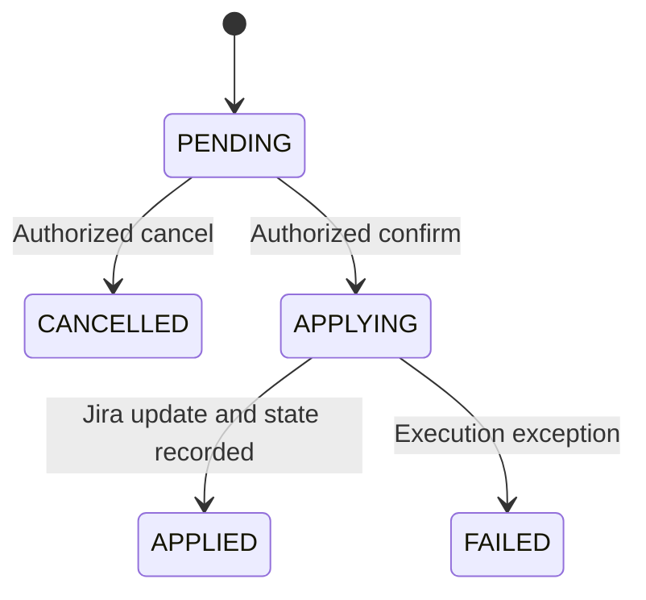

# Asset Approval & Defect Management

**Event-driven AWS infrastructure for secure, human-approved operational workflows in Slack.**


## Overview

Operational requests often begin in chat, but executing them directly against business systems creates security, reliability and accountability problems. This project separates request intake, asynchronous processing, AI-assisted risk analysis and authorized execution into independently permissioned components.

The defect workflow allows operators to review and update an existing Jira issue from Slack, without granting the language model access to Jira write credentials. The asset workflow establishes a separate request intake and persistence boundary for future approval automation.

**Core design principle:** AI advises; an authorized human decides; deterministic application code executes.

## Architecture



The AWS environment is deployed in `us-east-1` (N-Virginia). Lambda execution logs are collected in CloudWatch. The Qwen endpoint runs outside the AWS stack and is a separate integration dependency. The AgentCore harness is provisioned by Terraform but is not the model invocation path in the current Python worker.

## Engineering problems solved

| Challenge | Implementation |
| --- | --- |
| Slow or variable downstream response times | SQS decouples Slack acknowledgements from Jira reads and model inference. Confirmation invokes a separate Lambda asynchronously. |
| Traffic bursts and API protection | API Gateway default route throttling: **10 requests/sec**, burst **20**. These are best-effort ingress limits, not a guarantee of Jira or LLM throughput. |
| Failure isolation | Asset and defect workloads have separate encrypted queues, Lambda workers, IAM roles and data tables. |
| Transient processing failures | SQS redrive after 3 receives, 180-second visibility timeout, partial batch failure reporting, separate DLQs with 14-day retention. |
| Forged or stale Slack requests | HMAC-SHA256 request signature verification with constant-time comparison; timestamps outside a five-minute window are rejected; workspace ID is checked. |
| Unauthorized issue mutations | DynamoDB-backed operator roles, authorization checks at intake and again before execution, project-scoped Jira read validation, separate Jira read/write secrets. |
| Untrusted LLM output | Limited issue context, instructions to treat issue content as untrusted, strict JSON parsing, risk-level allowlist and bounded rationale. Model output cannot determine the write payload. |
| Concurrent approvals | Conditional DynamoDB transition from `PENDING` to `APPLYING` prevents multiple confirmation requests from independently claiming the same proposal. |
| Infrastructure drift and collaboration | Reusable Terraform modules, remote S3 state, native state locking, versioned state and reproducible Lambda packaging. |
| Operational visibility | CloudWatch Lambda logs (30-day retention), stored proposal outcomes, event records and DLQs support troubleshooting. |

## End-to-end defect workflow


Example Slack command:

```text
/defect-agent SCRUM-5 priority=High
```

1. **Authenticate and route.** API Gateway invokes the shared ingress Lambda. The ingress verifies the Slack signature and workspace, checks the user's operator role, then publishes the request to the defect SQS queue and returns an acknowledgement.
2. **Retrieve authoritative context.** The defect worker parses the issue key and requested fields, verifies that the issue belongs to the configured Jira project and retrieves its summary, status, priority and assignee using a read-only credential.
3. **Assess risk.** The worker sends a bounded issue snapshot and proposed change to the authenticated custom Qwen API. It validates the returned risk classification and rationale. The model has no Jira execution role.
4. **Persist and request approval.** DynamoDB stores a proposal with the exact requested priority, optional assignee, requester, AI risk assessment and `PENDING` status. Slack receives an ephemeral review message with Confirm and Cancel buttons.
5. **Execute deterministically.** On confirmation, the Jira executor rechecks the operator's authorization and proposal status, atomically claims the pending proposal and constructs a Jira REST update from the stored fields—not from model-generated instructions.
6. **Record the outcome.** The executor stores the final state and decision metadata and sends feedback to Slack. Cancellation does not update Jira.



The conditional state transition guards against repeated or concurrent confirmation attempts on a single proposal. It does **not** provide end-to-end exactly-once delivery across SQS, DynamoDB and Jira.

## AI integration and trust boundaries

### Custom Qwen model

The active risk-review implementation uses an authenticated HTTPS API. During the local demonstration, a Python API server and a Cloudflare tunnel make the model endpoint reachable from the AWS Lambda worker. The tunnel URL and bearer token are read from Secrets Manager, so neither needs to be committed to Git.

```text
Defect worker → HTTPS model endpoint → Qwen → validated JSON → Slack review
```

Expected model response (illustrative):

```json
{
  "risk_level": "MEDIUM",
  "rationale": "Review the operational impact before increasing the issue priority."
}
```

Only `LOW`, `MEDIUM` and `HIGH` are accepted. The rationale must be a nonempty string and is truncated to 400 characters. The review is advisory and cannot bypass human confirmation.

The setting `defect_agentcore_required` retains its original name for compatibility. With the default `false`, a failed Qwen review produces an `UNASSESSED` proposal for manual review. With `true`, a failed review prevents proposal creation and the worker reports processing failure. The current HTTP timeout for Qwen is 45 seconds.

### Amazon Bedrock AgentCore

Terraform also provisions a restricted AgentCore harness using Amazon Nova Lite by default, with one iteration, a 400-token maximum, a 30-second timeout and a dedicated model-invocation IAM role. The configured tool allowlist excludes the built-in tools. This represents the managed-model alternative; the current worker does not automatically switch to it when Qwen is unavailable.

The local Python server and tunnel configuration are not included in this repository. Start the separately maintained model service and provide its reachable endpoint before testing Qwen inference.

## Security architecture

| Component | Access boundary |
| --- | --- |
| Shared ingress | Read Slack signing secret, route messages, check defect operator authorization, invoke the executor. |
| Asset worker | Consume its own queue and maintain asset sessions/events. |
| Defect worker | Consume its own queue, read Jira and Qwen credentials, create proposals/events and hold scoped AgentCore invocation permissions. No Jira write secret. |
| Jira executor | Read the write credential, recheck authorization and read/update proposals. No model invocation required. |
| AgentCore harness | Scoped Bedrock model invocation role; no Jira credentials. |

Additional controls include SQS and DynamoDB server-side encryption, DynamoDB point-in-time recovery, private encrypted S3 state with TLS enforcement and versioning, and secrets populated outside Terraform to avoid storing credential values in state.

## Infrastructure as code

```text
.
├── bootstrap/                 # S3 remote-state infrastructure
├── environments/
│   └── dev/                   # AWS composition, variables, outputs, backend
├── modules/
│   ├── queue/                 # SQS + dead-letter queue
│   ├── dynamodb_table/        # On-demand encrypted tables, TTL, PITR
│   └── lambda_function/       # ZIP packaging, Lambda, IAM, CloudWatch
├── applications/
│   ├── shared_ingress/
│   ├── asset_worker/
│   ├── defect_worker/
│   └── jira_executor/
├── .github/workflows/         # Manually triggered OIDC Terraform plan
└── packages/                  # Generated artifacts (environment packaging path is local)
```

The environment composes small reusable modules with project/environment tags and explicit resource dependencies. Terraform packages Python source using the archive provider and tracks ZIP content hashes for deployment updates. The Lambda runtime is Python 3.13 on ARM64. DynamoDB uses on-demand billing and TTL for temporary data: asset sessions (1 day), asset events (7 days) and defect events (30 days). Authorization and proposals do not have TTL configured.

The repository contains a manually triggered GitHub Actions workflow that assumes an AWS role through OIDC, verifies identity, validates Terraform and generates a plan without applying. It requires repository variables and a configured IAM trust relationship. Its live execution status is not established here.

## Deployment guide

### Prerequisites

- Terraform `>= 1.15.0, < 2.0.0`, AWS CLI and an authenticated AWS principal with deployment permissions.
- Slack app and Jira Cloud project, with appropriate read and write credentials.
- A running Qwen-compatible API endpoint for custom-model testing.
- AWS Secrets Manager secret named `asset-defect-dev/qwen-api` in `us-east-2` **before planning**. Terraform looks this existing secret up rather than creating it. Populate it securely with `api_url` and `api_token` JSON keys, outside Terraform.

Run from the repository root in Windows PowerShell.

### 1. Bootstrap state

```powershell
Set-Location .\bootstrap
terraform init
terraform apply
$stateBucket = terraform output -raw state_bucket_name
```

### 2. Configure development environment

```powershell
Set-Location ..\environments\dev
Copy-Item .\backend.hcl.example .\backend.hcl
Set-Content .\backend.hcl "bucket = `"$stateBucket`""
Copy-Item .\terraform.tfvars.example .\terraform.tfvars
New-Item -ItemType Directory -Force .\packages | Out-Null
notepad .\terraform.tfvars
```

Replace the example Slack workspace ID. Do not put API tokens in the variables file. The S3 backend uses encryption and native lock files.

### 3. Validate and deploy

```powershell
terraform init -backend-config=backend.hcl
terraform validate
terraform plan -out=tfplan
terraform apply tfplan
terraform output
```

### 4. Configure integration secrets

Use the following Terraform outputs to locate the secret containers in AWS Secrets Manager. Populate the actual values securely in the console; these JSON structures are placeholders.

| Output / secret | JSON keys |
| --- | --- |
| `slack_secret_arn` | `signing_secret` |
| `jira_read_secret_arn` | `api_token`, `cloud_id`, `project_key` |
| `jira_secret_arn` | `api_token`, `cloud_id`, `project_key` |
| Existing `asset-defect-dev/qwen-api` | `api_url`, `api_token` |

Use distinct appropriately scoped Jira tokens for reading and writing. Do not commit secret values, local backend configuration, plan files or Terraform state.

### 5. Authorize defect operators

Obtain the Slack user ID, then grant the operator role in the authorization table. Replace the example ID.

```powershell
$tableName = terraform output -raw defect_authorization_table
aws dynamodb put-item --region us-east-2 --table-name $tableName --item '{"SlackUserId":{"S":"U0123456789"},"Enabled":{"BOOL":true},"Role":{"S":"defect_operator"}}'
```

### 6. Connect Slack

```powershell
terraform output -raw slack_commands_url
terraform output -raw slack_interactions_url
```

Register `/asset-agent` and `/defect-agent` with the commands URL, and configure Slack Interactivity with the interactions URL. Install the Slack app to the authorized workspace.

### 7. Functional verification

Use the following scenarios to validate a deployment against a test Jira issue. These are expected results, not a report of tests executed by this documentation change.

| Scenario | Expected behavior |
| --- | --- |
| Valid defect command | Acknowledgement, then a pending proposal in Slack and DynamoDB. |
| Confirm an authorized proposal | Requested Jira fields updated; proposal marked `APPLIED`. |
| Cancel a proposal | Proposal marked `CANCELLED`; Jira unchanged. |
| Repeat a completed confirmation | Already-handled proposal is ignored. |
| Unauthorized user / invalid signature | Request denied; no Jira update. |
| Unavailable model (default mode) | `UNASSESSED` risk; manual confirmation still required. |
| Unavailable model (required mode) | Request fails and is eligible for SQS retry. |
| Repeated worker failures | Inspect the corresponding DLQ and CloudWatch logs. |
| Asset command | Receipt and session/event records; no automated external approval. |

### 8. Clean up development resources

From `environments/dev`, review and execute the destroy plan when the environment is no longer needed:

```powershell
terraform plan -destroy
terraform destroy
```

The bootstrap state bucket has deliberate deletion protection. Retain it unless intentionally decommissioning remote state; the separately created Qwen secret and external integrations are not removed by the development stack.

## Current scope and engineering trade-offs

| Capability | Current repository state |
| --- | --- |
| Slack-to-Jira defect review and approved update | Implemented in the application code. |
| Custom Qwen advisory integration | Implemented; external model service required. |
| Bedrock AgentCore | Harness and IAM provisioned; not the active inference path. |
| Asset intake | Implemented as isolated intake, session persistence and acknowledgement. Full Airtable approval and AgentCore execution are not implemented in this worker. |
| Observability | Lambda logs, event records and DLQs configured. |

Further hardening would include stable request-level idempotency keys for SQS redelivery, DLQ alarms and redrive procedures, downstream rate limiting/backoff, automated integration tests, and reconciliation for ambiguous Jira write results or proposals stuck in `APPLYING`. A managed production model endpoint would remove the local tunnel dependency. No load-test results, SLA or exactly-once guarantees are claimed.

---

**Technical stack:** AWS API Gateway · Lambda · SQS · DynamoDB · Secrets Manager · IAM · S3 · CloudWatch · Bedrock AgentCore · Terraform · Python · Slack API · Jira REST API · Qwen
=======
# Asset-Defect-Management-System
>>>>>>> origin/main
